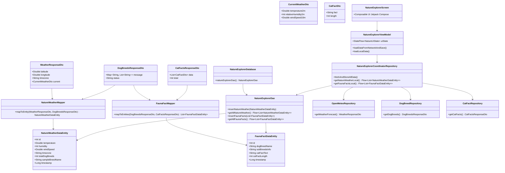

# 🌦️ Examen Tercer Parcial - Grupo 2: Explorador de Naturaleza y Clima

Repositorio oficial para el Examen del Tercer Parcial (Android con Kotlin, MVVM, Retrofit2, Room Database y Jetpack Compose).
**Estudiante:** David Silva

---

## 🏛️ Diagrama de Clases y Arquitectura

El siguiente diagrama muestra la arquitectura MVVM, los DTOs, las 2 Entidades/Tablas de Room, los Mappers, los 3 Repositorios de red y los componentes de UI:

---

## 📂 Ubicación de las Clases del Proyecto

Todas las clases fuente de la aplicación se encuentran organizadas bajo el paquete `com.example.examentercerparcialdavidsilva`:

### 1. DTOs (Modelos de Red)
- 📌 [`WeatherDto.kt`](app/src/main/java/com/example/examentercerparcialdavidsilva/data/dto/weather/WeatherDto.kt): Modelos JSON para Open-Meteo Weather API (`WeatherResponseDto`, `CurrentWeatherDto`).
- 📌 [`DogBreedsDto.kt`](app/src/main/java/com/example/examentercerparcialdavidsilva/data/dto/dog/DogBreedsDto.kt): Modelo JSON para Dog CEO API (`DogBreedsResponseDto`).
- 📌 [`CatFactsDto.kt`](app/src/main/java/com/example/examentercerparcialdavidsilva/data/dto/cat/CatFactsDto.kt): Modelos JSON para Cat Facts API (`CatFactsResponseDto`, `CatFactDto`).

### 2. Base de Datos Room, Entidades y DAO
- 📌 [`Entities.kt`](app/src/main/java/com/example/examentercerparcialdavidsilva/data/local/Entities.kt): Contiene las **2 Entidades/Tablas** con nombres genéricos:
  - `NatureWeatherDataEntity` (Tabla 1: Clima + Razas de Perros)
  - `FaunaFactDataEntity` (Tabla 2: Razas de Perros + Datos de Gatos)
- 📌 [`NatureExplorerDao.kt`](app/src/main/java/com/example/examentercerparcialdavidsilva/data/local/NatureExplorerDao.kt): Interfaz DAO para operaciones de inserción y lectura reactiva (`Flow`).
- 📌 [`NatureExplorerDatabase.kt`](app/src/main/java/com/example/examentercerparcialdavidsilva/data/local/NatureExplorerDatabase.kt): Instancia singleton de la base de datos Room.

### 3. Mappers (Transformadores de Datos)
- 📌 [`Mappers.kt`](app/src/main/java/com/example/examentercerparcialdavidsilva/data/mapper/Mappers.kt): Contiene los **2 Mappers**:
  - `NatureWeatherMapper`: Combina API 1 + API 2 $\rightarrow$ Tabla 1.
  - `FaunaFactMapper`: Combina API 2 + API 3 $\rightarrow$ Tabla 2.

### 4. Capa de Red y Repositorios
- 📌 [`ApiServices.kt`](app/src/main/java/com/example/examentercerparcialdavidsilva/data/api/ApiServices.kt): Interfaces Retrofit (`OpenMeteoApiService`, `DogCeoApiService`, `CatFactsApiService`).
- 📌 [`RetrofitClient.kt`](app/src/main/java/com/example/examentercerparcialdavidsilva/data/api/RetrofitClient.kt): Cliente singleton de Retrofit.
- 📌 [`Repositories.kt`](app/src/main/java/com/example/examentercerparcialdavidsilva/data/repository/Repositories.kt): Contiene los **3 Repositorios independientes** (`OpenMeteoRepository`, `DogBreedRepository`, `CatFactRepository`).
- 📌 [`NatureExplorerCoordinatorRepository.kt`](app/src/main/java/com/example/examentercerparcialdavidsilva/data/repository/NatureExplorerCoordinatorRepository.kt): Repositorio coordinador que une los repositorios con los mappers y la base de datos.

### 5. Arquitectura MVVM y UI
- 📌 [`NatureExplorerViewModel.kt`](app/src/main/java/com/example/examentercerparcialdavidsilva/ui/viewmodel/NatureExplorerViewModel.kt): ViewModel con estado reactivo `StateFlow`.
- 📌 [`NatureExplorerScreen.kt`](app/src/main/java/com/example/examentercerparcialdavidsilva/ui/screen/NatureExplorerScreen.kt): Pantalla principal construida con Jetpack Compose y pestañas para cada tabla.
- 📌 [`MainActivity.kt`](app/src/main/java/com/example/examentercerparcialdavidsilva/MainActivity.kt): Actividad principal que inicializa la DB, repositorios y ViewModel.

---

## ✅ Checkpoints Completados
- **Checkpoint 1 – Compilación** [15/15]
- **Checkpoint 2 – Diseño de clases y Base de Datos** [25/25]
- **Checkpoint 3 – Implementación de APIs (3 Repositorios)** [30/30]
- **Checkpoint 4 – Implementación de Base de Datos, MVVM y Compose** [30/30]
