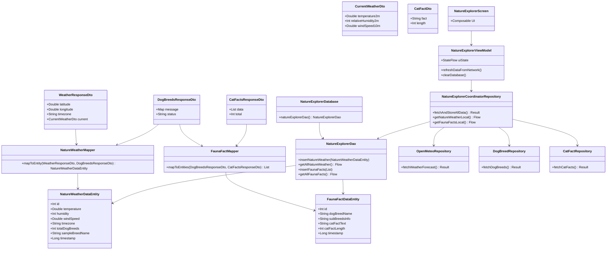

# Examen Tercer Parcial - Grupo 2: Explorador de Naturaleza y Clima

Estudiante: David Silva

## Diagrama de Clases

## Ubicación de las Clases en el Proyecto

- DTOs de Red: `app/src/main/java/com/example/examentercerparcialdavidsilva/data/dto/`
- Entidades y DAO Room: `app/src/main/java/com/example/examentercerparcialdavidsilva/data/local/`
- Mappers: `app/src/main/java/com/example/examentercerparcialdavidsilva/data/mapper/`
- Servicios y Repositorios API: `app/src/main/java/com/example/examentercerparcialdavidsilva/data/api/` y `data/repository/`
- ViewModel y UI Compose: `app/src/main/java/com/example/examentercerparcialdavidsilva/ui/`
