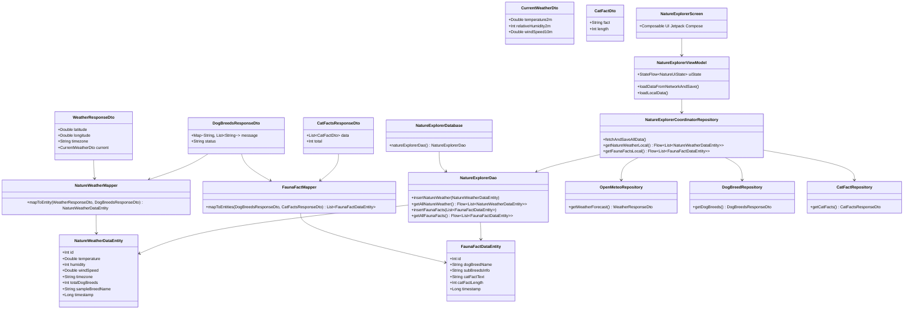

# Diagrama de Clases y Arquitectura - Explorador de Naturaleza y Clima

Este documento describe la arquitectura MVVM, los DTOs, Entidades de Room, Mappers, Repositorios y componentes de UI del proyecto **ExamenTercerParcialDavidSilva** (Grupo 2).

## Arquitectura General (MVVM)

## Explicación de los Componentes

### 1. DTOs (Data Transfer Objects)
- **`WeatherResponseDto` / `CurrentWeatherDto`**: Modelan la respuesta de la API Open-Meteo (Clima La Paz: temperatura, humedad, velocidad de viento).
- **`DogBreedsResponseDto`**: Modela la lista de razas y subrazas de perros devueltas por la Dog CEO API.
- **`CatFactsResponseDto` / `CatFactDto`**: Modelan los 10 datos curiosos de gatos de la API Cat Facts.

### 2. Entidades de Base de Datos (Room)
- **`NatureWeatherDataEntity` (Tabla 1)**: Entidad combinada que almacena información meteorológica (API 1) junto a métricas de la fauna canina (API 2).
- **`FaunaFactDataEntity` (Tabla 2)**: Entidad combinada que almacena información cruzada entre razas de perro (API 2) y datos curiosos de gatos (API 3).

### 3. Mappers
- **`NatureWeatherMapper`**: Combina la respuesta de API 1 y API 2 en una sola instancia de `NatureWeatherDataEntity`.
- **`FaunaFactMapper`**: Combina la lista de razas de perro (API 2) y los datos curiosos de gatos (API 3) en una lista de `FaunaFactDataEntity`.

### 4. Repositorios
- **`OpenMeteoRepository`**, **`DogBreedRepository`**, **`CatFactRepository`**: Tres repositorios individuales para aislar la comunicación con cada API.
- **`NatureExplorerCoordinatorRepository`**: Repositorio coordinador que consulta los tres repositorios individuales, ejecuta los mappers y persiste el resultado en la base de datos Room.

### 5. Arquitectura MVVM
- **`NatureExplorerViewModel`**: Maneja el estado reactivo (`StateFlow<NatureUiState>`), gestiona la carga de datos sin bloquear el hilo principal y previene excepciones no controladas.
- **`NatureExplorerScreen`**: UI declarativa con Jetpack Compose que presenta las tres secciones y datos de la base de datos local.
